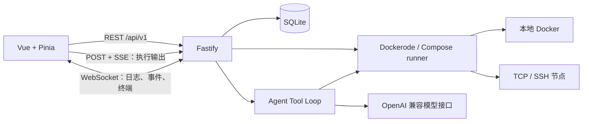

# ComposeOps 架构

按 2026-11-03 的源码整理。ComposeOps 是单用户 Docker Compose 运维台，由 Vue 单页应用、Fastify API、SQLite 和 Docker Engine 组成。[app.js](../../backend/src/app.js) 组装应用，[index.js](../../backend/src/index.js) 监听端口并启动后台调度。

## 组件与通信



| 层 | 实现 |
| --- | --- |
| 前端 | Vue 3.5、Vue Router 5、Pinia 4、Vite 7、Tailwind CSS 4 |
| 编辑与终端 | Monaco、monaco-yaml、xterm |
| 服务端 | Node.js 22+、Fastify 5、ES modules |
| 持久化 | 默认 Node.js 22 `node:sqlite`；配置静态加密时使用 `better-sqlite3-multiple-ciphers` |
| Docker | dockerode、Docker Compose CLI、ssh2 |

依赖版本以两侧 package.json 和 lockfile 为准，后端直接运行 JavaScript。

## 页面与状态

路由采用 hash history，例如 `/#/logs?projectId=...&containerId=...`，项目/容器上下文通过 query 传递。完整定义见 [router.js](../../frontend/src/router.js)。

| 页面 | 入口 |
| --- | --- |
| 总览、服务、配置 | `/dashboard`、`/services`、`/compose` |
| 日志、终端、监控 | `/logs`、`/shell`、`/monitor` |
| AI 会话、执行记录、巡检 | `/agent`、`/agent/history`、`/inspection` |
| 事件、工作流、定时任务、GitOps | `/events`、`/workflows`、`/cron`、`/gitops` |
| 运维任务、发布与回滚 | `/ops-center`、`/review` |
| 资产、拓扑、节点组 | `/cmdb`、`/topology`、`/node-groups` |
| 应用市场、存储、成本、设置 | `/marketplace`、`/resources`、`/cost`、`/settings` |

旧 `/ai`、`/blueprints`、`/operations` 分别重定向到 `/agent`、`/marketplace`、`/events`。

前端 [api/client.js](../../frontend/src/api/client.js) 对指定 GET 请求使用内存 SWR：返回缓存并后台刷新，显式强刷等待新响应。成功写入失效缓存，旧请求不能写回被替换的条目。节点切换递增缓存代次并广播 `composeops:host-changed`；页面/store 仍需丢弃迟到响应。

[App.vue](../../frontend/src/App.vue) 通过白名单保活页面。流式或轮询页面应在离开时释放连接/定时器，不能直接加入 keep-alive。Escape 和滚动锁由 `useEscapeKey.js` 统一管理。

## 项目发现与执行

[scanner.js](../../backend/src/services/scanner.js) 从 Compose 标签读取项目名、工作目录和文件列表。Docker 扫描使用 3 秒缓存及同客户端请求合并；返回独立快照，纳管/目录权限和备注每次读取数据库最新值。项目操作结束后主动失效扫描缓存。

[docker-hosts.js](../../backend/src/services/docker-hosts.js) 管理客户端与全局活动节点，选择保存在 `docker.active_host`；活动节点或连接配置变化会通知容器事件订阅迁移。

| 场景 | 执行方式 |
| --- | --- |
| 本地文件已挂载且可编辑 | direct：本地 Compose CLI |
| 本地路径未直挂但处于允许范围 | workspace：按需 runner 访问宿主文件 |
| SSH 节点 | 远端 SSH 读写和执行，mountState=remote_ssh |
| 只有 TCP Docker API | containers：现有容器控制，不编辑远端 Compose 文件 |

managed 是操作前提，mountEnabled 和路径范围共同决定编辑能力。[project-action-runner.js](../../backend/src/services/project-action-runner.js) 为 API、工作流和 Agent 提供入口，通过项目锁串行化同一项目的操作。

Compose 操作用 POST 请求读取 SSE 输出，不使用 EventSource 自动重连；连接结束必须明确处理，避免重放写操作。

## 日志、事件与终端

- [docker-log-stream.js](../../backend/src/services/docker-log-stream.js) 按 TTY 配置区分原始流和 Docker 多路复用帧。单容器/聚合日志共用 UTF-8 解码、完整行组装、时间戳和级别解析。
- [container-events.js](../../backend/src/services/container-events.js) 按完整 JSON 行解析 Docker Events，串行处理，断线重试，无订阅者时停止连接。
- [routes/ws.js](../../backend/src/routes/ws.js) 在初始化前登记关闭处理，断连后销毁迟到流。终端先预留会话槽位，再缓冲初始化期间的输入和窗口尺寸。
- 日志页暂停显示时仍接收数据；缓冲有上限并展示丢弃数量。流结束和连接错误分别展示，结束后不自动重连并重复历史。

## Agent 单通道

工作台和抽屉共用 [useAgentChat.js](../../frontend/src/composables/useAgentChat.js)。执行入口为 `POST /api/v1/ai/agent/execute-stream`，审批入口为 `POST /api/v1/ai/agent/approve`；日志页的 `POST /api/v1/ai/diagnose` 独立保留。

Tool Loop 每轮调用模型，解析工具调用，检查权限/风险/审批，回传结果后继续。入口在 [agent.js](../../backend/src/services/agent.js) 和 [engine.js](../../backend/src/services/agent/engine.js)，工具名、数量及权限以注册表为准。

- 历史由后端读取。ai_sessions.compacted_before_id 标记模型活跃窗口，compact_summary 存摘要；渲染仍读取全量历史。
- approval-gate 支持 ask、allow_writes、full；critical 始终确认，会话记忆不能绕过。
- 持久化策略由 `agent/policy-store.js` 管理（迁移 v17）：deny-first，按完整工具名、项目 ID 和参数子集精确匹配。allow 只可免除 low/medium 独立工具确认；critical、宏及工具元数据声明的硬确认仍由原审批门控制。编辑确认参数后重新计算风险并重新应用拒绝规则。
- 每次工具调用拥有稳定的 `agent_executions.id`，关联的 `agent_audit_events` 记录策略判定、审批、执行结果和后置检查。审计只保存脱敏详情与参数指纹，清理 plan 不会级联删除审计事件。
- secret-redactor 收集敏感值并脱敏出站文本，日志/文件/页面上下文作为不可信证据。
- background-tasks 使用 SQLite `agent_background_tasks` 保存任务状态、心跳和脱敏输出；完成结果进入事件中心，运维中心可跨 Agent 会话查看、读取和停止任务。`runaway-guard` 检测重复动作；空模型轮次最多提醒重试一次。
- SSE token 的协议清理由后端有状态发射层完成，前端原样追加；逐 token trim 会破坏 Markdown 空白和换行。

## Autonomous Ops：Worker Runtime 与运行可观测性

ComposeOps 采用渐进式 Worker Profile，而不是复制一套平行 Agent 引擎：

- planner 负责澄清目标、范围和验收标准；executor 负责按明确目标执行；validator 是只读角色；incident_responder 面向故障现场。
- auto 路由由 resolveAgentRole() 使用确定性规则完成。意图不明确时回退到 planner；模型不负责选择角色或扩大权限。
- 每个角色的 systemPrompt 约束工作方法，allowedTools 限制可见工具；两者都不能替代 Tool Registry、deny-first 策略、风险计算和 approval-gate。应急角色同样不能绕过人工确认。
- Worker 选择结果通过脱敏 SSE trace worker_selected 展示，执行计划仍落在原有 agent_plans / agent_executions / agent_audit_events 体系，不新增平行任务数据库。
- Agent 工作台可选择本轮 Worker；执行历史可按关键词、状态和 Worker 筛选。useAgentChat 的编辑重发、重新生成和中断续接允许携带同一轮上下文参数。

交互参考采用“借鉴模式，不复制页面”：[Coolify](https://github.com/coollabsio/coolify) 的项目/资源层级、[Portainer](https://github.com/portainer/portainer) 的环境上下文与资源概览、[Komodo](https://github.com/moghtech/komodo) 的多主机视角、[Temporal UI](https://github.com/temporalio/ui) 的运行检索/筛选/事件历史，以及 [LangGraph](https://github.com/langchain-ai/langgraph) Studio 的逐步执行追踪。ComposeOps 应优先把会话、后台任务、工作流、事件和审批呈现为同一条可追溯的运维任务脉络，而不是让用户在多个聊天窗口间切换。

### Unified Command Center

- /ops-center 使用 frontend/src/views/AutonomousOpsView.vue，从现有 API 汇聚 Agent 计划、Agent 后台任务、工作流实例、批量任务、统一事件、操作历史和 Agent 审计；不新增并行任务表、不改变原始记录生命周期。
- 任务列表支持关键词、来源和标准化状态过滤，并突出待审批、执行中、失败及 outcome_unknown。详情按来源回读原始任务/工作流/Job/Agent 计划，时间线仅按明确的实例 ID、计划 ID、会话 ID 或项目 ID 关联；不会只凭时间相近把不同任务拼接。
- 工作流审批只对 waiting_approval 且带有效 pendingApprovalIntent 的实例显示通过操作；操作必须经过 UI 二次确认，再调用原有后端冻结意图/定义指纹校验。Agent 工具审批继续在原 Agent 会话中完成，任务中心只提供返回会话的深链。
- 事件观察页只允许更新事件状态，不会根据事件内容、日志或外部消息触发 Docker/Compose 操作。事件路由仍由确定性规则管理；Observe → Suggest → Approval → Execute 不等于自动授权。
- outcome_unknown 只显示真实核对提示，不提供自动重试。停止后台任务也仅向原任务 API 发出明确请求，不能把“请求停止”谎报为“已停止”。
- 原 /events、/workflows、/agent/history 专业页面继续保留；原定时运维计划编辑器从 /ops-center 迁移到 /maintenance-plan，避免丢失计划编排功能。

## 后台任务、事件触发与审批安全

- Agent 后台任务 API：`GET /api/v1/ai/agent/tasks` 列表、`GET /api/v1/ai/agent/tasks/:taskId` 读取详情/输出、`POST /api/v1/ai/agent/tasks/:taskId/stop` 请求停止。任务记录保存在 SQLite，进程内仅保留当前执行句柄；输出写入前经 `redactSecrets` 脱敏并受长度上限约束。
- 进程启动恢复时，无法恢复执行闭包的 `running` / `stopping` 任务标记为 `outcome_unknown`，不自动重放 Docker 操作。Task Watchdog 默认每 30 秒检查一次，超过 90 秒没有心跳的 Agent 任务或运行中工作流会转为 `outcome_unknown` 并写入告警事件；操作者需核对目标 Host/项目真实状态。
- [event-router.js](../../backend/src/services/event-router.js) 采用确定性规则匹配事件触发定义，不让 LLM 决定是否启动工作流。Docker Events、告警和统一事件中心是事件来源；匹配字段包括明确的事件类型，以及可选来源、动作、严重级别和项目范围。工作流自身事件被忽略以防递归，事件 ID 与数据库幂等键防止重复创建实例。
- Cron 工作流由同一 Event Router 定时扫描，按服务端本地分钟判断是否到期，并用工作流 ID + 分钟键做数据库幂等；重复 tick 或进程重启不会在同一分钟重复创建实例。
- Approval 节点进入 `waiting_approval` 时冻结审批节点 ID、完整工作流定义 SHA-256 指纹和下一可达 Action 的节点/动作/项目快照。审批时再次比较当前定义与快照；定义在等待期间发生变化、快照缺失或意图不一致时返回 `WORKFLOW_APPROVAL_STALE`，必须取消并重新运行。通过后只签发一次性授权，Action 执行前校验节点、动作、项目和定义指纹，并先持久化消费凭证再触发外部副作用。

## 长期运维任务：Ticket / Mandate / Assignment / Report / Effect

长期任务以 Ticket 为稳定身份，独立于任意 Agent Session。一个 Ticket 可以经历多个 Assignment；Assignment 只引用既有 Agent Session、Plan、后台任务、工作流或批量任务，不复制或替换现有 Worker Runtime。交接会保留旧 Assignment 并创建新序号记录，必须携带交接摘要。实现位于 [ops-tickets.js](../../backend/src/services/ops-tickets.js) 与 [ops-tickets routes](../../backend/src/routes/ops-tickets.js)，页面为 [OpsTicketsView.vue](../../frontend/src/views/OpsTicketsView.vue)。

- Ticket 保存目标、背景、优先级、来源、项目/Host 范围和验收标准；状态转换由后端限制。Ticket 只有存在人工接受的结构化报告后才能标记为 succeeded。
- Mandate 是不可变授权快照：限定内部 project / host / resource，以及独立的精确 Compose 项目名范围、允许动作、拒绝动作、策略版本、到期时间和 SHA-256 指纹。Compose 项目名绑定到快照指纹；旧授权不会因此自动获得新的 Docker 检查能力。签发新版本会撤销旧版本；撤销/替换会拒绝尚未执行的待审批、排队和已领取 Effect。审批、领取和执行开始前都会重新核对授权版本与目标范围。
- Assignment 记录角色、执行人、已有来源 ID / Session ID、尝试、状态与交接信息。Ticket 身份不随 Session 结束、替换 Worker 或交接而改变。
- Report 采用结构化摘要、发现项、证据和提交时的验收标准快照。提交报告只进入 review；人工接受/退回有独立审计事件。完成 Ticket 必须有 accepted Report。
- Effect 记录 Observe / Suggest / Execute 意图、风险、目标、参数、Mandate 指纹、审批人、租约、尝试次数与结果。幂等键以 Ticket 为边界；同一幂等键只能重放语义相同的请求，不同参数返回冲突。
- Controlled Effect Worker 已连接持久化队列，但生产白名单严格只有 service.inspect 与 container.inspect 两种低风险只读 Docker 查询。两个动作都要求 Mandate 同时明确授权 ComposeOps projectId 和 Docker Compose 项目名；container.inspect 可进一步限定资源 ID。未知动作、无效风险值、非 Execute 模式、非低风险、额外参数和远程 Host 在执行前拒绝；没有 Compose 写入、镜像拉取、容器/卷变更、SSH 或 Shell Handler。详情见 [OPS_EFFECT_WORKER.md](./OPS_EFFECT_WORKER.md)。
- Worker 领取后会在执行开始前重新验证人工审批、Mandate 指纹/期限/动作/目标范围，并在只读请求期间续租；Docker 返回结果经过字段白名单与值级脱敏后持久化。Worker 状态通过 `/api/v1/ops-tickets/worker/status` 提供。
- 恢复策略区分阶段：过期 leased（尚未记录开始）可安全回队列；过期 executing 无法证明副作用是否完成，转为 outcome_unknown，禁止自动重放，必须基于真实 Host/项目状态人工核对。
- Observe → Suggest → Approval → Execute 是治理流，不是自动授权。事件规则继续由确定性 Event Router 触发；此领域层不会把所有事件自动升级成 Ticket，也不会自行派发高风险动作。

迁移版本 v19 创建 ops_tickets、ops_mandates、ops_assignments、ops_reports、ops_effects 和 ops_ticket_events。接口前缀为 /api/v1/ops-tickets；现有 /ops-center 继续展示运行态势，长期任务入口为 /tickets。

## 数据与认证

结构和迁移的唯一来源是 [lib/db.js](../../backend/src/lib/db.js)，不要另写一份建表脚本。

| 数据域 | 主要表 |
| --- | --- |
| 配置与认证 | settings、sessions |
| 项目与备份 | project_preferences、compose_backups、volume_backups |
| 会话与用量 | ai_sessions、ai_history、ai_memories、ai_usage |
| 操作与执行 | operation_history、agent_plans、agent_executions、agent_audit_events、agent_policy_groups、agent_policy_rules、agent_background_tasks、background_jobs |
| 长期运维任务 | ops_tickets、ops_mandates、ops_assignments、ops_reports、ops_effects、ops_ticket_events |
| 观测与资产 | container_metrics、inspections、alert_events、event_records、assets、asset_relations |
| 工作流 | workflow_definitions、workflow_instances、workflow_steps |

[lib/auth.js](../../backend/src/lib/auth.js) 用 scrypt 存管理员密码哈希；会话令牌只存哈希，cookie 使用 HttpOnly、SameSite=Strict 和 30 天有效期。写请求检查 Origin，WebSocket 也要求认证。设置中的 API Key/SSH 凭据不等于数据库加密；展示脱敏与导出过滤是另外的控制。

命名卷备份使用短生命周期 helper 生成 tar.gz，支持下载、临时卷演练、还原和保留策略。删除归档失败时保留数据库记录以便重试。

## 验证与运行

```sh
# 仓库根目录；后端 test 已固定 --test-concurrency=1
DB_PATH=/tmp/composeops-test.db npm test --workspace backend
npm test --workspace frontend
npm run lint
npm run build
npm --prefix frontend run build:preview
npm --prefix frontend run test:preview
```

端口和部署参数以现有配置为准，此次没有修改 `0.0.0.0:28765:3001`。实测与边界见 [审查记录](../audit-2026-09-29.md)。
