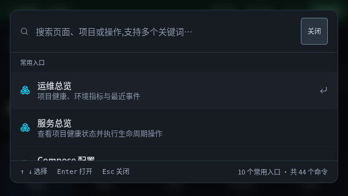

# 日志断线补读、节点隔离与短屏操作复核

本轮接续 8e52ef4，处理上一轮明确保留的断线数据缺口和持续运行验证。没有重新设计已经完成的总览与服务工作区。

## 发现与改进

- 日志重连原来仍请求初次读取的最近 200 行。断网期间输出超过 200 行会遗漏较早记录，也会把已显示的行重复追加。现在每次真正建立连接前，从已显示及暂停缓存中提取各容器的读取位置，向前重叠一秒补读，每容器最多 5000 行。用完整时间戳（保留纳秒）、容器 ID、stdout/stderr、正文和出现次数消除缓存中的重复行；真实重复消息、不同流和不同容器不会被合并。
- 动态续读参数与连接身份分离，刷新项目信息不会因为游标变化而中断正在运行的连接。清屏、切换项目或容器会清空补读状态；后端只接受受限格式的游标，按纳管项目中的精确容器 ID 匹配。
- 日志页处于 KeepAlive 后台时，切换 Docker 节点原来会跳过清理。现在后台也清空旧节点日志、选择和游标，返回后重新选择来源；后台不会为了刷新列表创建新连接。
- 快速跳转面板现在限制整体高度，短屏中仅结果列表滚动，搜索框、关闭入口和底部说明持续可见。手机关闭入口使用中文和至少 44 × 44 px 的点击面积。
- WebKit 原有的面板边缘偶发越界断言不再放宽容差：面板实际留出边距，测量前等待进入动画结束。完整回归还暴露了首页懒加载尚未就绪就按 Tab 的测试时序问题，已等待刷新按钮可用后再验证跳过导航。

## 参考依据

- [Docker CLI 官方日志文档](https://github.com/docker/cli/blob/master/docs/reference/commandline/container_logs.md)：明确 `--since`、`--tail`、`--follow` 可以组合，日志时间戳保留 RFC3339Nano。使用 Docker 自身的日志读取能力，避免额外维护一份无界服务端日志缓存。
- [Dozzle 官方 README](https://github.com/amir20/dozzle)：实时日志、容器模糊搜索、多栏与较小内存占用。延续此前已实现的容器筛选、多栏和阅读位置保护，本轮重点补齐断线与缓存边界。
- 本轮 web 搜索工具没有返回结果，以上资料由官方 GitHub 原文直接取得；没有据此声称新的星数排名或照搬截图。

## 验证记录

- 前端完整单测 548 项通过，84 个文件；后端完整单测 506 项通过、1 项跳过，随后新增的多容器位置隔离用例所在文件 5 项全部通过（最终总数交由 CI 复核）。Lint、生产构建和预览构建通过。
- Chromium / WebKit × 桌面 / 手机：首轮完整浏览器回归 187 项通过、8 项按设备跳过、1 项首页就绪时序失败。修正等待条件后，相关两组测试 36 项全部通过；补读、去重和来源切换的定向组此前 36 项全部通过。没有用放宽像素容差掩盖越界。
- 持续预览负载运行 915.3 秒，注入 900,000 条带容器 ID 和时间戳的日志，每分钟切换 1440 px / 390 px 视口。最多渲染 28 行；每 100 条同步注入最高耗时 8.7 ms；15 次垃圾回收后堆内存为 8.16–8.43 MB，最后 8.36 MB；无页面异常和横向溢出。这是浏览器缓存/布局负载，不是 Docker 网络吞吐基准。
- `scripts/log-reader-soak.mjs` 保留可复现的持续负载检查；`LOG_SOAK_SECONDS` 可设置更长时长。`scripts/project-workspace-browser.mjs` 在独立临时项目执行真实离线期间 360 行补读、计数、首尾记录、已有行去重及恢复后的新输出检查，覆盖聚合和单容器流。
- 候选镜像真实 Docker 检查通过直连/workspace × 1440/390 px 四组。桌面两组分别验证了聚合/单容器两次断网，各 360 条全部恢复；四组均通过备注持久化、配置预览与保存、未保存导航拦截、应用配置后项目身份不变、终端连接和取消停止。测试仅操作随机命名的临时项目，结束后清理。

## 实际边界

补读不是持久化日志归档，也不保证严格无损。Docker 已轮转或删除的记录无法恢复；容器重建会获得新 ID；每容器补读最多 5000 行，页面总共保留最近 5000 行。没有可靠容器 ID 或时间戳时回退最近日志并提示可能重复或缺失。超过 64 个有游标的容器时回退初次读取，避免握手参数膨胀。

没有连接可用 iPhone，也没有本机 Apple 调试环境。Linux WebKit 和 iPhone 尺寸模拟不能替代真实 Safari 的动态地址栏、软键盘及真机触摸测试。持续负载结果仅代表记录中的时长与场景，不能推出数小时运行无泄漏。
