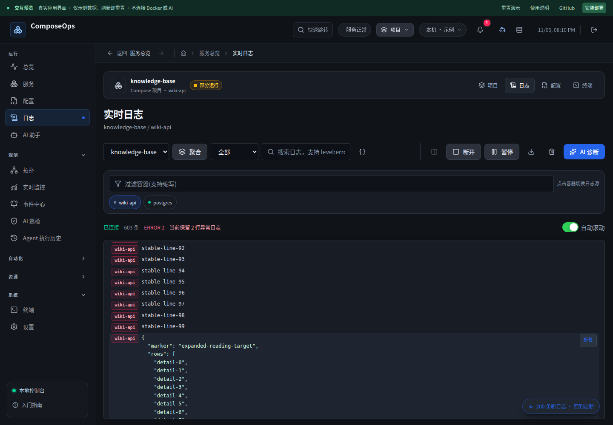
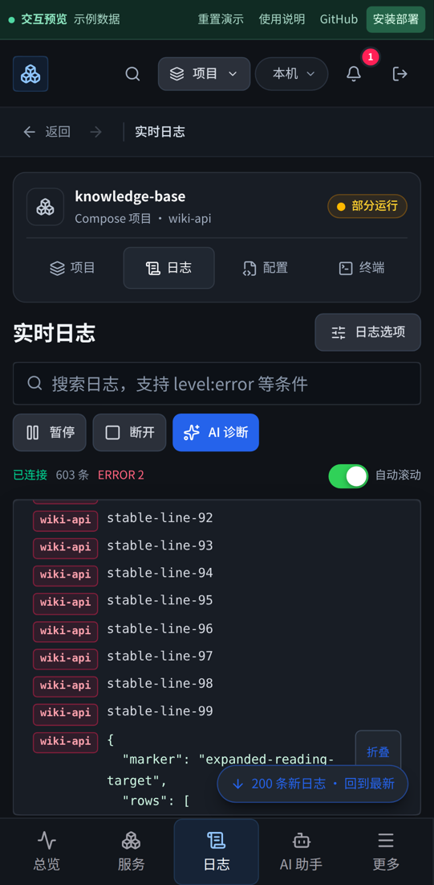

# 日志阅读稳定性与断线恢复

本轮补齐上次评审中明确留下的可变高度日志、持续写入和连接恢复问题，并将 WebKit 桌面与 iPhone 尺寸加入浏览器回归。

## 参考资料与取舍

2026-11-06 调用 Web 搜索和网页读取工具未得到结果，随后直接读取官方源码文档：

- TanStack Virtual 官方 `virtualizer.md`：稳定 ID、动态高度测量、尺寸变化时的滚动补偿。来源：`https://raw.githubusercontent.com/TanStack/virtual/main/docs/api/virtualizer.md`。采用这些原则，在现有 5000 条缓冲区内实现高度前缀和与二分定位，没有为单一列表增加第三方运行依赖。
- Playwright 官方 `browsers.md`、`test-projects-js.md` 与设备描述，通过 Context7 读取。来源：`https://github.com/microsoft/playwright/blob/main/docs/src/browsers.md`。WebKit 是测试用引擎，Linux 上的 iPhone 参数模拟不能等同于真实 Safari/iOS。

## 修复内容

| 原问题 | 最终行为 |
| --- | --- |
| 固定 24px 估算与实际行高不一致，JSON 展开后偏移累积 | ResizeObserver 测量可见行，通过稳定 ID 和行内偏移维持阅读位置 |
| JSON 滚出虚拟窗口再返回后自动折叠 | 展开状态保存在日志页，跨虚拟卸载、筛选、分栏合并保持；日志淘汰后释放 |
| 老日志被 5000 条缓冲区移除时，阅读位置跳到其他内容 | 当前行仍保留就保持该行；已经过期则定位最早保留行并明确提示 |
| 高频消息逐条修改深层响应式数组、逐条裁剪 | 按动画帧合并显示更新，每批裁剪一次；仅渲染可见窗口，暂停队列仍有上限 |
| JSON 与图表放大小文字按钮在手机上难点 | 扩大触摸区域至 44px；JSON 折叠按钮随长内容阅读保持可用；图表按钮键盘聚焦可见 |
| 聚合多选更新后 WebSocket 仍指向旧 URL，全选/清空未触发重连 | 所有选法重建对应来源，清除旧来源内容；同 URL 刷新不重复连接 |
| 建连一直 CONNECTING，构造失败不再重试 | 10 秒握手超时，统一指数退避与最大重试次数，耗尽后可手动重试 |
| 离线期间不停重试，恢复在线不能及时继续 | 离线暂停重试，联网立即恢复；主动断开、离开缓存页面和卸载均释放监听和计时器，日志下拉刷新也随缓存页面激活/失活 |
| 半开连接一直显示已连接 | 日志专用 15 秒 ping 与 10 秒应答超时，失效后重连；终端不启用此协议 |
| 重连时只有一条 WARN，容易被过滤或误判为业务异常 | 独立恢复提示和普通信息分隔行，明确最近日志重读可能重复或有缺失；暂停时不越过显示队列 |

## 验证

- 前端全量 83 个文件、541 项通过，包括 keep-alive 资源释放。
- 后端 504 项通过、1 项跳过；包括单容器与聚合日志心跳、断开释放和正常结束。
- ESLint、生产构建、预览构建与差异空白检查通过。
- 浏览器新增回归覆盖 JSON 展开/折叠、虚拟卸载后返回、搜索与分栏切换、5000 条上限、两秒约每秒 1000 条输入、阅读锚点保留/过期提示、离线/上线、手动重试、主动关闭和离开页面。
- 一分钟持续写入：60.9 秒内输入 60,000 条，最多渲染 28 行；最后一条可见，5000 条保留上限有效，无浏览器异常。该数据来自本机 Chromium 模拟流。
- 完整浏览器回归首次有效执行：183 项通过、8 项按设备跳过；1 项 WebKit 手机后退动画时序测试改为等待滚动恢复，返回、图表放大和日志跟随各重复三次，9 项全部通过。最终 CI 结果另存发布记录。
- 真实 Docker 候选镜像在直接挂载和 workspace 模式、1440/390px 均通过：备注、日志、配置审阅/保存/应用、导航拦截、项目身份、终端与取消停止。两种模式的桌面浏览器额外验证真实心跳、浏览器离线/上线和重新连接后新的容器 stdout；随机临时资源已清理。

本地 WebKit 缺少的 libavif/libgav1/libyuv 从 Ubuntu 软件包解出到测试浏览器目录；CI 使用 Playwright 官方 `install --with-deps chromium webkit`。没有将本地路径或二进制加入仓库。

## 发布与边界

发布前生成 559,857,664 字节的数据库在线备份（权限 0600），并保留原生产镜像回滚标签。部署继续使用两个 Compose 文件、外置只读数据库密钥、原数据卷与 28765 端口。

日志恢复仍是重新获取配置的最近条数，**不是完整无损续传**。两秒突发和一分钟持续负载验证的是交互与缓冲区行为，不是数小时压力测试。WebKit 与移动设备参数模拟也不代表真实 Apple 硬件验证。本轮未调用付费 AI，也未对已有业务项目执行写入操作。

## 页面截图

