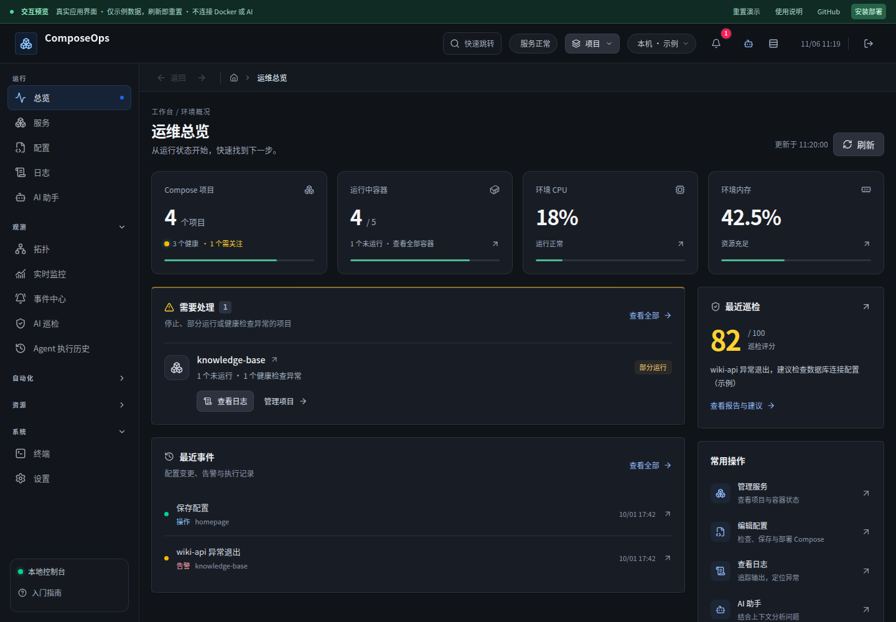
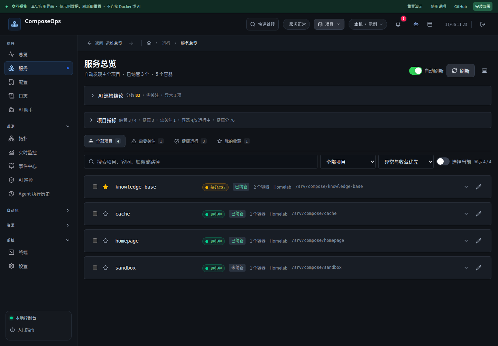
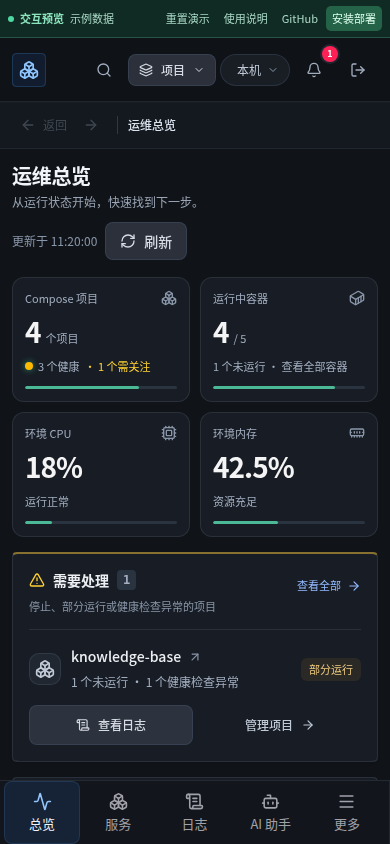

# 工作台视觉与操作路径改进 · 2026-11-06

本轮重点是让人更快看出“现在是什么状态、哪里需要处理、下一步去哪”。全站沿用中文与深色界面，重新统一画布、面板、文字和交互层次；总览和服务页做了布局与操作路径调整。

## 参考资料与取舍

网页搜索接口本轮未返回有效结果，随后直接访问官方页面，读取 Grafana 文档，用真实浏览器查看 shadcn/ui 示例，并查看 Dokploy 官网提供的产品截图。星标数由 GitHub API 于 2026-11-06 查询，为当时快照。

| 项目 | 星标 | 实际查看的资料 | 本轮采用的设计思路 |
| --- | ---: | --- | --- |
| Dokploy | 38,268 | [官网](https://dokploy.com/)、官网 `dashboard.webp` 产品截图、[仓库](https://github.com/Dokploy/dokploy) | 以项目为主要操作对象，服务列表将搜索和筛选放在一起，状态与操作贴近项目 |
| Grafana | 77,719 | [仪表盘最佳实践](https://grafana.com/docs/grafana/latest/visualizations/dashboards/build-dashboards/best-practices/)、[仓库](https://github.com/grafana/grafana) | 从概况向问题下钻，用明确链接减少反复查找；颜色表达实际状态；URL 参数承载视图条件 |
| shadcn/ui | 127,452 | [Dashboard 实例](https://ui.shadcn.com/examples/dashboard)、[仓库](https://github.com/shadcn-ui/ui) | 数字、标题、辅助说明分层；安静的面板、统一圆角和边界；清晰的操作层级 |

此前 Dockge、Coolify、Portainer、Homepage、Dozzle、Komodo 等比较见 [首轮评审](2026-11-05-design-ux.md)；本轮在此基础上落地统一方案。没有引入第三方 UI 框架，也没有复制上述项目的源码或图片资产。

## 发现与修改

1. **统计、快捷入口和事件卡片权重相近。** 首页调整为四张核心指标卡，再以主列显示待处理项目、最近事件，侧列显示巡检和常用操作。手机使用双列紧凑指标和单列内容。
2. **异常首页缺少直接处理入口。** 项目异常可直接打开未运行容器的日志；若容器都在运行，则打开健康检查失败的容器。日志携带首页来源，普通返回和新标签页的兜底返回均能回到总览。
3. **“查看全部”未应用对应筛选。** 首页待处理区现在进入 `services?filter=attention`；服务页提供全部、需关注、健康和收藏四个带数量的快捷筛选。
4. **筛选只存在于当前组件内存。** `q/filter/sort` 随 URL 保存；刷新、详情返回、前进都可恢复。输入修改使用 replace，不为每个字符新增历史。非法或重复参数安全回退；缓存页面不读写其他页面的查询参数；清除筛选保留任务等无关参数。
5. **服务页面首次进入被展开的巡检和统计推低。** 首次默认显示一行概况，可展开并记住用户偏好，项目列表更早进入视野。
6. **状态表达有误导。** 部分运行不再写成未运行；已停止或已退出容器优先展示实际生命周期，避免被旧的 healthy 检查覆盖。补齐创建、退出、失效、删除、启动等中文状态。
7. **装饰与反馈混杂。** 移除静态面板的整体悬浮发光和常态健康标记的持续闪动；进行中的操作保留动态反馈。统一全站中性色阶，并给文字链接单独设置较亮的颜色。删除退役的首页样式，新增布局使用局部样式。
8. **键盘要经过大量导航才能到内容。** 添加“跳到主要内容”入口，焦点移动后可直接操作页面；已有焦点边框、减少动态效果和移动端导航继续保留。
9. **最近事件缺少后续路径。** 操作、告警、Agent 和定时记录可进入各自页面；巡检摘要完整展示，不再挤进截断的小统计卡。

## 架构判断

Vue 页面、共享状态和 composable 的分工适合当前单用户 Compose 工作台。此次把地址筛选同步提取为 `useServiceFilters`，把异常说明与日志目标提取为纯函数，避免页面各自解释一套状态。全站颜色回到共享变量，首页布局留在组件内，减少继续往全局样式末尾叠加页面补丁。

后端接口、Agent Tool Loop、数据库结构和实时订阅方式本轮无需变更。现有 keep-alive 激活/失活资源管理、草稿离页拦截、危险操作确认门均纳入回归。

## 浏览器截图

截图使用隔离演示数据，不含生产项目与密钥。

## 验证与发布

- 前端：79 个测试文件，498 项通过。
- 后端：502 项通过，1 项按环境跳过。
- 浏览器：66 项通过，4 项按视口跳过；覆盖全站导航、审批交互、表单、返回/前进、草稿保护、320/390/768/1024/1440/1920/2560px 布局。
- ESLint、正式构建、隔离预览构建、`git diff --check` 通过。
- 候选镜像：真实后端桌面/手机操作通过；首次安装、鉴权、重启持久化、旧版升级、在线备份和新卷恢复通过。
- 发布前保存回滚镜像 `stanly1997/opsdash:rollback-design-20261106-1115`，加密备份 549,662,720 字节，文件权限 0600。
- 生产继续使用原端口 `0.0.0.0:28765:3001`、`composeops_opsdash-data` 数据卷和外置密钥只读挂载，同时使用两个 Compose 配置文件。
- 线上镜像、健康检查、鉴权和加密核验的发布记录保存到本机 `~/.local/state/composeops/releases/2026-11-06-overview-design.json`。

回归时修正了旧测试对“常态持续闪动”和“停止容器仍显示健康”的断言。临时 Docker 容器创建引起过一次 Chrome `ERR_NETWORK_CHANGED`，容器验证结束后完整重跑浏览器套件，未屏蔽该错误或降低断言。

测试边界：数据丰富的全站操作使用隔离预览；真实候选镜像验证首次安装、登录、保存、刷新、返回和升级恢复。AI 审批交互使用模拟执行，未调用付费模型、发送通知或改变生产业务容器。
