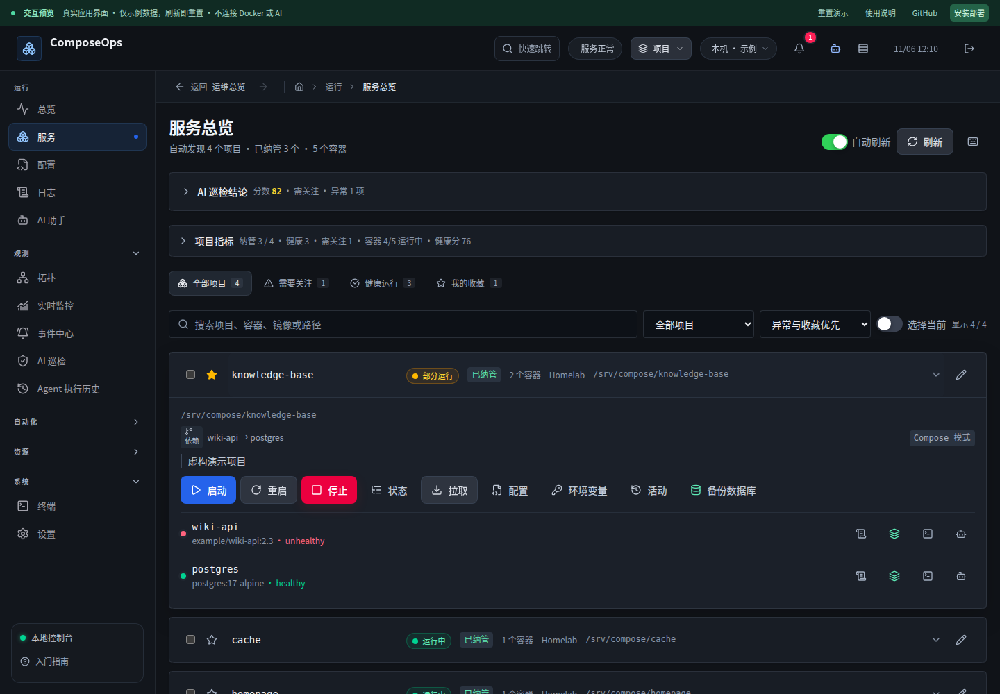
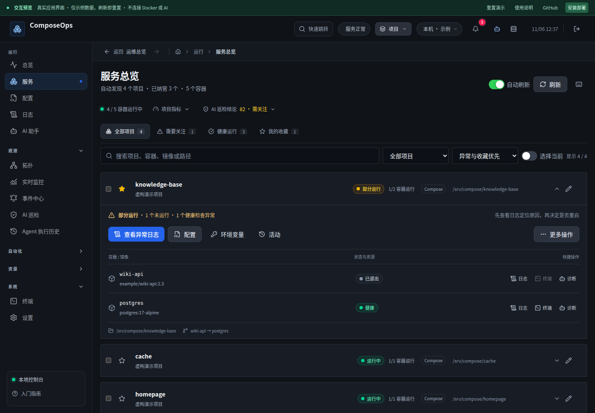
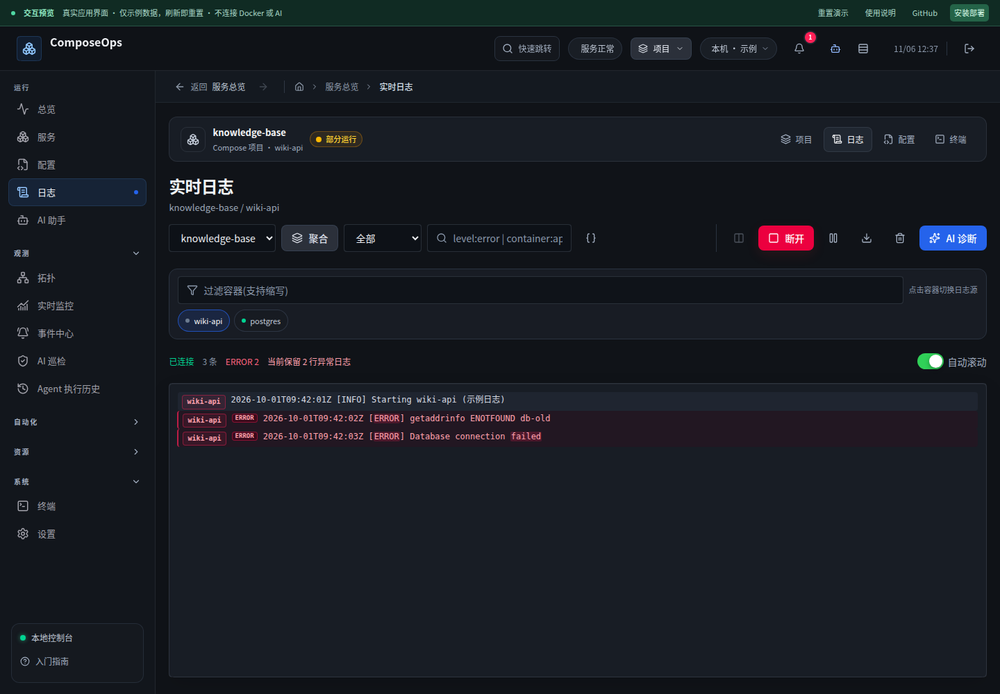
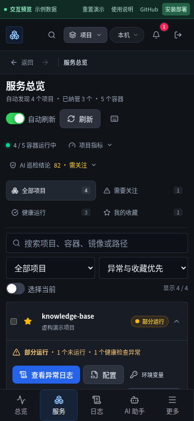
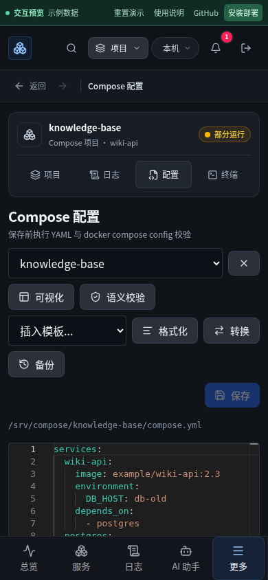

# 项目工作区：界面层级、操作闭环与真实后端复核

这次评审的结论不是“所有功能完善”。前一轮改善了总览，却没有充分解决项目内任务的连续性。本轮围绕“服务 → 日志 → 配置 → 保存 → 应用 → 验证”完成一轮具体改进。

## 实际参考

调研日期：2026-11-06。搜索工具未返回内容，改用官方网站和 GitHub API 读取原始资料，没有把无法打开的页面当成参考。

- Linear 官方文章《How we redesigned the Linear UI (part II)》，2024-03-28：对齐、降低视觉噪声、导航层级、按实际视图做压力测试。来源：`https://linear.app/now/how-we-redesigned-the-linear-ui`。本轮读取完整正文；不声称访问其登录后的工作区。
- Coolify，GitHub API 当日 65,689 stars。实际读取 `resources/views/components/resource-heading-tabs.blade.php`：资源内固定导航、移动端当前项可见、使用 aria-current 表示当前位置。来源：`https://github.com/coollabsio/coolify`。借鉴资源上下文与工具切换，而非复刻代码或增加无关平台功能。
- Dockge，GitHub API 当日 24,762 stars。实际读取 `frontend/src/components/Container.vue`：按容器状态提供操作，运行时才提供终端，详细信息渐进展开。来源：`https://github.com/louislam/dockge`。

- Docker 官方 Compose project name 文档：显式项目名优先于环境变量、顶层 name 和目录名。真实集成发现自定义项目名会在应用时丢失，按此规则修复执行参数。来源：`https://docs.docker.com/compose/how-tos/project-name/`。

## 找到并解决的问题

| 原问题 | 本轮结果 |
| --- | --- |
| 服务列表前两块摘要占据首屏，项目出现太晚 | 收为一行可展开概况，保留用户折叠偏好；手机筛选栏两列排列 |
| 展开后启停、配置、备份等十余入口竞争注意力 | 日志与配置优先；维护动作集中到更多操作，风险操作有明确确认和影响说明 |
| 列表信息缺少稳定对齐，容器动作依靠猜图标 | 统一项目身份、状态、模式、路径；容器行显示中文状态、镜像、指标与带文字的操作 |
| 配置/日志/终端相互割裂 | 固定项目工作区导航保留项目、容器和来源；配置页返回日志仍指向原容器 |
| 刷新或定位项目会清空筛选 | 返回携带搜索、状态、排序；定位到筛选外项目时临时置顶并解释，不清空原筛选 |
| 视觉禁用的链接仍能键盘激活 | 不可用入口不输出 href；停止容器不能打开终端，深链也解释原因且不连接 |
| 浏览器原生备注框缺少错误恢复，失败时先修改本地值 | 应用内表单、字数提示、忙碌状态、错误保留草稿，服务端成功后才更新 |
| 折叠卡片也读取每个项目的 Compose/env | 移除无必要的环境读取，依赖文件展开后才加载，指标流收起时释放 |
| 文件保存后没有明确下一步 | 清楚说明保存不会更新容器，提供返回项目应用配置入口 |
| SSE 正常关闭被当成成功，健康检查失败仍弹升级完成 | 明确退出码/结果帧决定反馈，验收失败优先；结果未知显示“尚未确认”，不猜成功 |
| 自定义名称启动的项目在应用时按目录名创建另一组容器 | 直接执行、workspace 和 SSH 共用显式项目名参数；临时文件校验也保留原项目身份 |
| 重建成功后立即打开终端仍指向旧容器 | 流式操作结束或中断后再次失效缓存；单项与批量操作完成后强制刷新项目数据 |
| 从更多操作打开确认窗取消后焦点丢失 | 关闭菜单前先恢复触发器焦点，弹窗关闭后返回同一入口 |

浏览器回归发现了“定位清筛选”和“取消丢焦点”。第一版真实 Docker 测试只核对目标容器运行；清理测试资源时发现残留的第二组容器，说明这个验收标准不够严格。补上原项目 label 与同目录仅一组容器的断言后，又复现了重建后的旧终端链接。两处都修改产品代码修复，保留更严格的断言。

## 验证

- 前端 82 文件 / 526 项通过；后端 503 通过、1 跳过。
- 桌面和 Pixel 7 浏览器：76 通过，4 按设备类型跳过。包含全部路由、表单、导航、过滤、草稿、弹窗、减少动画、320/390/768/1440px。
- 生产构建、预览构建、ESLint、git diff --check 通过。
- 独立候选镜像 + 临时 Compose 项目 + 独立数据库，直接挂载与 workspace 两种模式，在 1440px 和 390px 均通过：真实备注写入并刷新、实时日志、配置修改、离开取消、变更预览、保存落盘、应用配置、Docker inspect 确认运行、原项目 label 不变、同目录仅一组容器、立即连接新容器终端、取消停止后容器继续运行。测试只纳管和操作随机命名的临时项目，结束删除测试容器及目录；可用 `node scripts/project-workspace-browser.mjs <候选镜像>` 重跑，增加 `--workspace` 测试工作区执行。两种模式已加入 CI 的 AMD64 镜像任务。
- 安装/升级/在线备份与新卷恢复镜像 smoke 已通过。正式部署使用加密覆盖配置和外部密钥挂载，保留既有数据卷与 28765 端口；发布前生成数据库备份和回滚标签。

## 截图

改前：

改后：

## 仍然存在的产品边界

- 本轮集中在项目核心工作流，没有宣称自动化、资产、成本、AI 等所有模块达到相同成熟度。
- 界面回归和隔离环境集成不能替代真实用户的长期使用反馈。大规模项目数据和远程节点网络异常仍值得单独压力测试。SSH 路径共用修复后的参数构建，但本轮没有连接真实远程 SSH 节点验证。
- Compose 保存与应用是两个明确步骤；命令成功与业务健康也分别呈现。不会把零退出码描述成业务必然正常。
- 公共预览使用示例数据，真实 Docker 行为以独立候选容器测试为证据；没有执行付费 AI 请求或现有业务项目启停。
