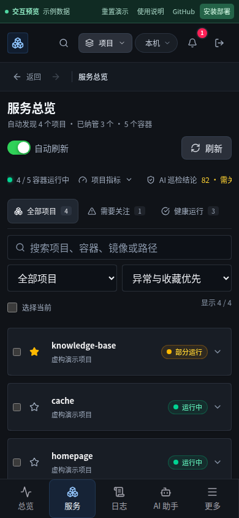
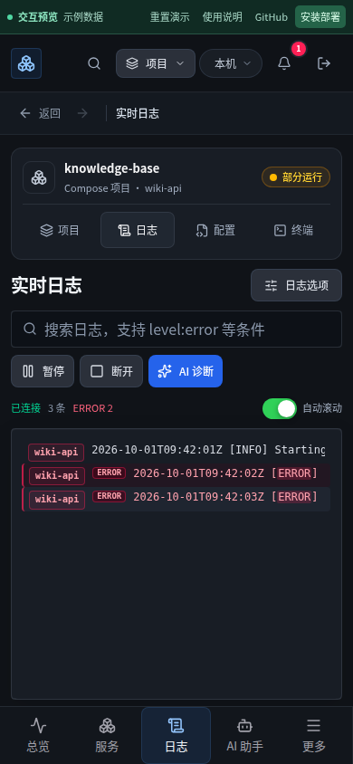
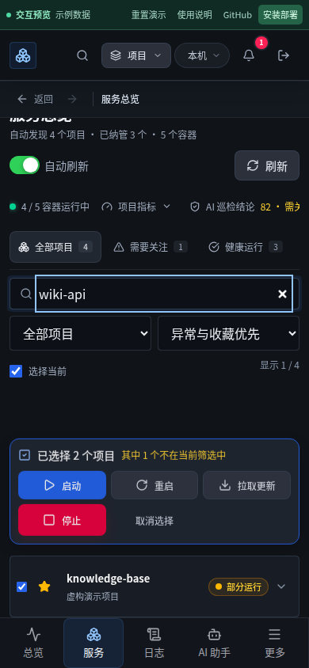
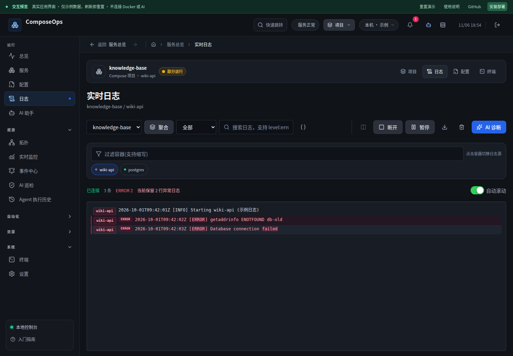
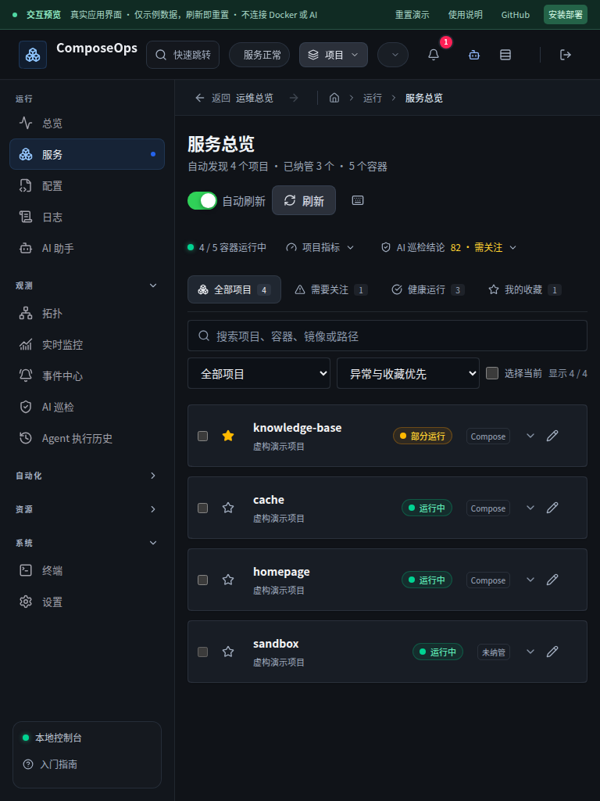

# 日志阅读、移动布局与批量操作复核

本轮继续围绕“常用页面是否看得清、操作对象是否明确、阅读是否被打断”改进。结论仍是存在提升空间，不能据此宣称所有功能完善。

## 参考与取舍

2026-11-06 再次使用 Web 搜索，但搜索工具未返回可用结果，随后直接读取官方资料：

- Carbon Design System 的 Data table / Batch actions：选中后显示批量操作栏，可明确取消。本轮采用可见的选择状态与批量操作区，并针对项目筛选补充隐藏选中项计数和具体项目确认。来源：`https://carbondesignsystem.com/components/data-table/usage/`。
- Dozzle 官方 README：容器模糊搜索、日志查询、分栏和实时指标。本轮确认现有功能覆盖这些基础能力，优先减少工具栏拥挤和修复阅读体验，没有为对标重复添加同类功能。来源：`https://raw.githubusercontent.com/amir20/dozzle/master/README.md`。GitHub API 本轮限流，没有记录未经核实的最新星数。
- 前一轮实际阅读的 Linear、Coolify、Dockge 资料与项目导航实现，见 [项目工作区评审](2026-11-06-project-workspace.md)。

## 本轮解决

| 发现 | 改进 |
| --- | --- |
| 手机服务页概况、快捷筛选占据过多纵向空间 | 一行概况和可横向浏览的快捷筛选，项目卡片更早进入首屏 |
| 平板侧栏挤压搜索框，输入区域接近零宽 | 768px 服务搜索独占一行，其余筛选换行 |
| 手机日志正文被大量控件挤出首屏 | 搜索、暂停、连接与诊断常驻；来源、分栏、下载等放入“日志选项” |
| 收起选项可能隐藏正在生效的级别筛选 | 独立显示当前级别与清除入口 |
| 向下滚一点就恢复自动跟随，打断历史阅读 | 只有到底部或点击“回到最新”才恢复；显示新日志计数 |
| 大量日志进入时，虚拟列表渲染后没有真正滚底 | 渲染完成后对齐底部，区分内容重排与用户向上滚动 |
| 手机虚拟列表与浏览器滚动锚定、Home 滚动终点冲突 | 在日志区域关闭滚动锚定，Home 明确跳到第一条；触摸期间的新数据不抢滚动位置 |
| 筛选后仍选中的项目不可见，批量确认只报数量 | 操作栏提示筛选外选中数，确认列出实际项目与操作影响，固定确认时的目标集合 |
| “拉取后重启即可更新”提示不准确 | 明确拉取只下载镜像，需应用配置更新容器；无法编辑的项目禁用批量拉取 |
| 手动刷新返回缓存、缺少反馈，失活页面仍监听下拉 | 强制读取最新响应、刷新中禁用重复提交，下拉监听随 keep-alive 激活/失活 |
| 没有日志一律显示等待，无法判断原因 | 区分未选来源、无匹配、断开、已结束和等待新日志 |

## 验证与边界

- 前端 82 个测试文件、528 项单测通过；日志相关 23 项在最终逻辑修改后再次通过。
- 完整浏览器回归：84 项通过，4 项按设备类型跳过。覆盖全部页面导航、筛选、确认取消、状态反馈及本轮新行为。
- 滚动回归在桌面和手机各重复 3 次通过，覆盖大量日志初始跟随、Home 返回顶部、轻微向下滚动不抢回底部、新日志计数与显式恢复。
- 320/390/768/1440px 页面截图与实际输入、选择操作已检查；平板搜索压缩问题由实际操作发现并修复。
- ESLint、生产镜像构建、预览构建与 git diff --check 通过。
- 独立候选镜像在直接挂载和 workspace 两种模式、1440px 和 390px 均通过：备注持久化、真实日志、配置校验/保存/应用、离开拦截、项目身份不变、容器重建后终端连接、取消停止；测试资源已清理。
- 发布前保留当前镜像回滚标签，并生成 557,936,640 字节的加密数据库在线备份。部署沿用加密覆盖文件、原数据卷和 28765 端口。

单测和公共预览使用模拟数据；真实 Docker 集成使用独立候选容器与随机命名临时项目，不操作现有业务项目。预览未执行付费 AI 请求。

本轮没有覆盖真实 iOS/Safari、多远端节点弱网或长期高吞吐日志压力。日志仍采用固定高度估算的虚拟窗口；大量展开 JSON 的可变高度阅读需要专门评估。自动化、资产、成本等模块的产品深度不因本轮核心页面改进而自动视为完善。

## 页面效果

