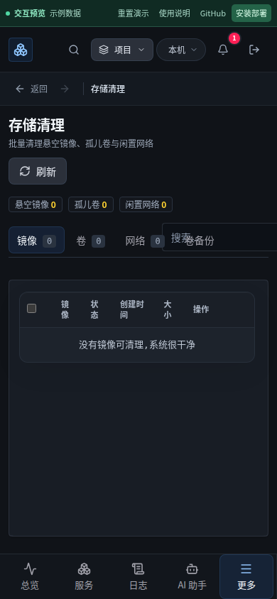
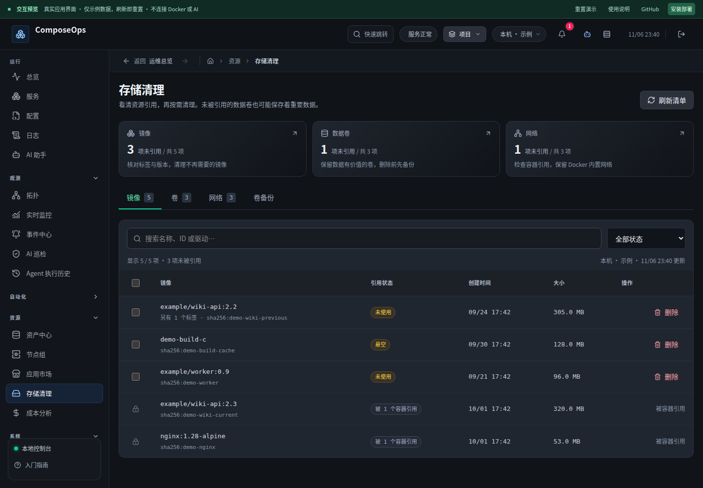
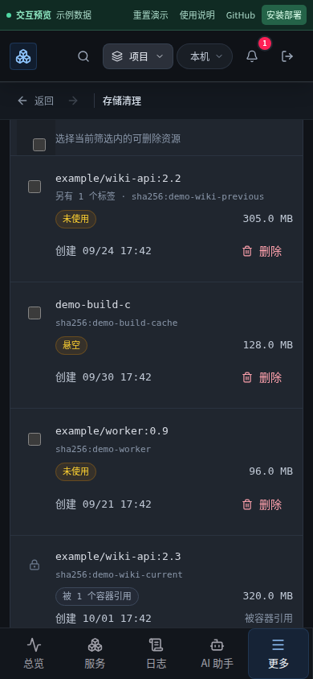
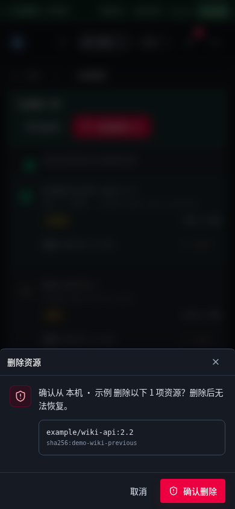
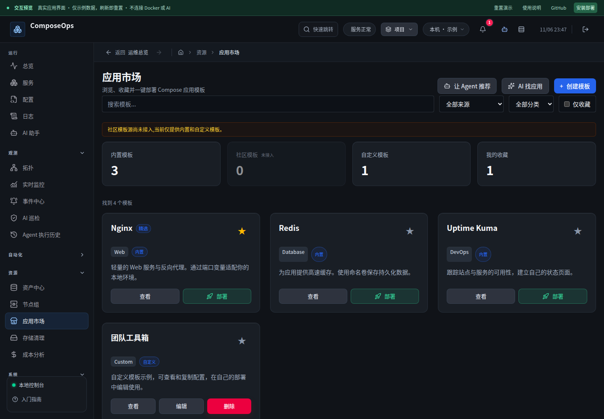
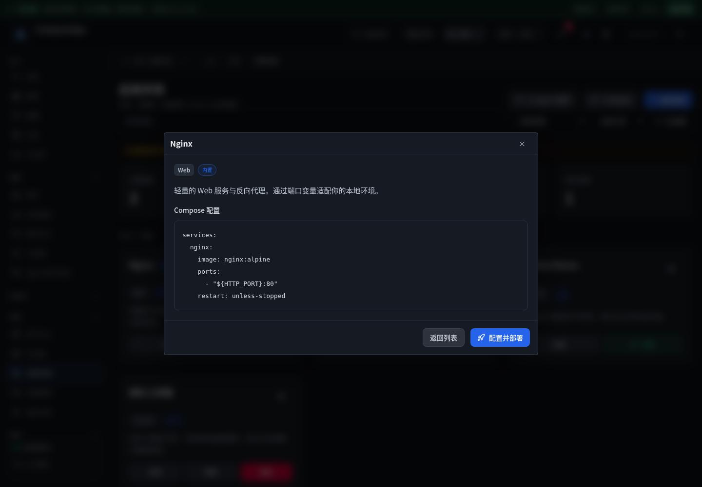

# 资源清理与连续操作体验复查

基线：`900b74d`。本轮继续在已有导航、日志阅读与服务工作区改进上复查，完成资源管理、操作详情和应用市场三轮改动。所有公开截图使用虚构的离线预览数据；真实 Docker 验证只创建和清理随机命名的临时资源。

## 参考与取舍

本次 web 搜索接口没有返回有效结果，随后直接读取官方资料，不以未核实的星数或“最新设计”作论据。

- [Portainer：删除网络](https://docs.portainer.io/user/docker/networks/remove)：先识别引用、勾选目标，再通过确认框删除。对应修正 ComposeOps 的自建 bridge 判定、停止容器引用检测与精确目标确认。
- [Carbon：Data table](https://carbondesignsystem.com/components/data-table/usage/)：选择后出现独立批量操作栏，批量模式禁用单行操作，可显式取消选择。对应隐藏选择计数、当前筛选内全选、批量确认和失败保留。
- [Dockge README 与官方界面截图](https://github.com/louislam/dockge)：查看了项目列表、同屏配置与实时输出的关系。参考其“对象 → 操作 → 即时结果”的就近反馈，修复后台任务输出不随推送刷新的问题，并补齐模板详情到部署再返回的路径。
- [Dozzle 入门说明](https://dozzle.dev/guide/getting-started)：查阅其独立部署、可选容器操作与多宿主配置。本轮未扩大默认运维权限，延续已有日志工作区。

保留中文、暗色和 emerald 状态色。按真实问题调整布局与流程，没有为了视觉变化重写所有页面。

## 第一轮：资源清理

原有窄屏截图中标签与搜索框重叠，表格空态占据大面积空间。新的资源概览可以直接筛选未引用资源；标签、筛选、批量操作分别占据独立区域。手机使用卡片式资源行，仍保留状态、大小、创建时间和可见的删除入口。

- 可用方向键、Home/End 切换标签；标签进入 URL，浏览器后退恢复上一类型；备份标签不显示无效的资源筛选。
- 筛选不会隐式丢失已选项；“全选”仅作用于当前可见资源，隐藏选择明确计数；确认框列出名称与实际 ID。
- 单项和批量删除共用固定目标快照，执行时禁用竞争操作。保留成功与失败反馈，未完成目标可重新核对。
- 切换节点或离开页面停止剩余批量请求；旧请求不能覆盖新节点清单。服务端校验清单的节点 ID，并把已接受请求绑定到原 Docker 客户端。
- 镜像引用以全部容器的 ImageID 补充判定；网络按默认名称识别内置网络，结合全部容器的网络引用判断是否闲置；删除网络前再次检查引用。
- 停止容器同样保护资源；删除仍不使用 force。未知卷大小显示“未统计”，不伪装成空卷。
- 预览资源数据修正为真实 API 结构，增加虚构镜像、卷、网络和仅在内存生效的删除演示。

## 第二轮：操作记录与后台任务

- 修正向已有时区的日期重复追加 Z 导致的 Invalid Date。统一处理 SQLite UTC、ISO Z、时区偏移和毫秒时间戳。
- 详情显示项目、时间与结果，手机任务列表限制高度，为输出留出空间。
- SSE 推送同步当前项目输出；选择不同任务、关闭详情或卸载组件后，迟到的响应不会重开详情、串写输出或恢复轮询。
- 请求中有加载反馈，失败可重试；SSE 中断且任务仍活跃时才降级轮询。

## 第三轮：应用市场

- 统计卡片可以筛选来源与收藏；显示结果数量和重置入口；收藏与保存期间防止重复提交。
- “查看 → 配置并部署 → 返回详情 → 返回列表”保持单一弹窗和原列表筛选，不需要关闭后重新寻找模板。
- 模板卡片在 320px 宽度下不溢出，收藏按钮保证触控面积。
- 暂离页面清理搜索计时器并失效旧请求；返回后刷新。
- 修正预览 stats/results 字段，补入虚构模板和内存收藏操作。离线演示不执行真实部署或调用模型。

## 验证与发布

复查开始于 2026-11-06，验证与发布收尾于 2026-11-07（Asia/Shanghai）。

- 前端：86 个文件、568 项测试通过。
- 后端：515 项通过，1 项既有条件跳过；测试串行执行。
- Chromium / WebKit 桌面与手机：全站 200 项通过，8 项设备条件跳过，0 重试。最后调整手机卡片间距后，对本轮相关流程再次验证 12 项全通过。
- lint、生产构建与预览构建通过。
- `node scripts/resource-cleanup-integration.mjs`：真实 Docker 临时镜像、数据卷、自建 bridge 网络；验证停止容器引用、跨节点拒绝和解除引用后清理；测试资源全部清理。
- 另启动完整 Fastify + 构建前端，使用临时数据库、随机密码及回环地址，真实浏览器登录、筛选、确认并删除临时卷；截图与页面快照确认完成提示持续可见，Docker 复核临时卷不存在。测试期间没有操作已有业务资源。
- 预览演示的搜索、选择、详情、取消、确认和返回均实操截图检查；样例模板部署只走到配置与返回，不执行真实应用部署或付费 AI。
- 部署前生成独立数据库备份（563,986,432 字节），保留原镜像回退标签。部署必须保留原数据卷、外置加密密钥与端口映射。

完整回归覆盖服务、日志、配置草稿、导航、Agent 审批门、备份、设置等已有流程。测试仍不能证明所有 Docker 版本、远端 SSH 环境与任意第三方模板均无缺陷；当前已发现的问题已落实修复与针对性验证。
