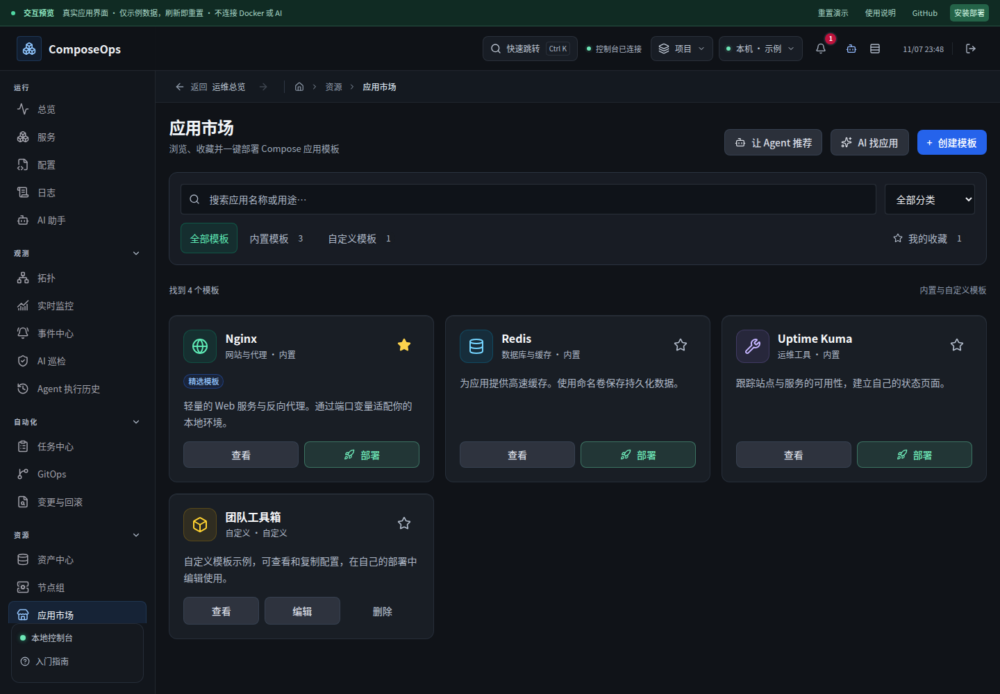
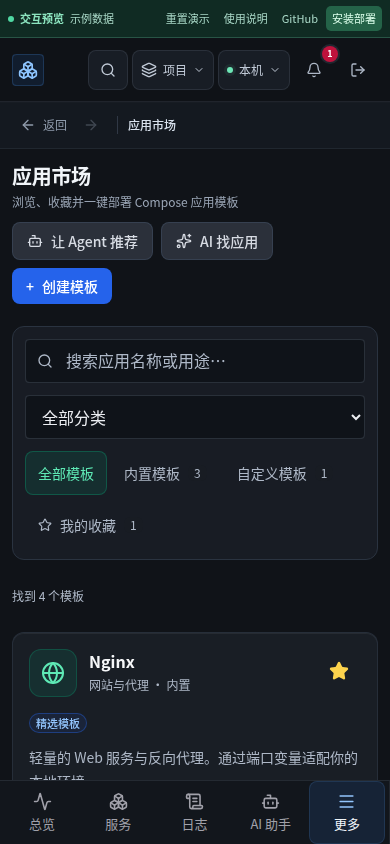

# 应用市场浏览体验复查

基线 `4a167e0`。重新扫描 24 个页面后，本轮只调整应用市场，不重复此前登录、服务和监控改进。

## 研究与观察

本轮 web 工具仍返回空输出，使用直连重新读取 [Carbon 数据表](https://carbondesignsystem.com/components/data-table/usage/)、[Carbon 空态](https://carbondesignsystem.com/patterns/empty-states-pattern/)、[Linear 筛选](https://linear.app/docs/filters) 和 [Portainer 容器入口](https://docs.portainer.io/user/docker/containers)。参考集中筛选、明确当前条件、就近恢复和对象级操作；没有把这些资料当成某个产品“最好看”的证明。Dokploy 模板旧链接返回 404，未作为参考证据。

截图显示原市场页来源下拉与四个统计卡重复，未接入的社区来源占用整条警告和一张卡。模板卡缺少易扫读的分类标识。

## 改动与验证

- 来源、数量和收藏合并到紧凑筛选区；搜索可单独清空，分类以中文展示。
- 模板卡增加分类图标与配色，收藏区分实心和轮廓；保留完整描述与既有详情、配置、返回流程。删除动作降低视觉权重，继续经过确认。
- 搜索等待期间旧请求不能更新结果；清空与立即筛选取消延迟请求。已有列表保留，避免每次输入导致卡片闪空。
- 保留键盘焦点与触控面积；减少动态效果偏好关闭卡片位移。

市场单测 12 项通过；资源与市场浏览器流程 Chromium/WebKit 桌面和手机 12 项通过；前端 lint 与预览构建通过。截图来自虚构数据预览。

