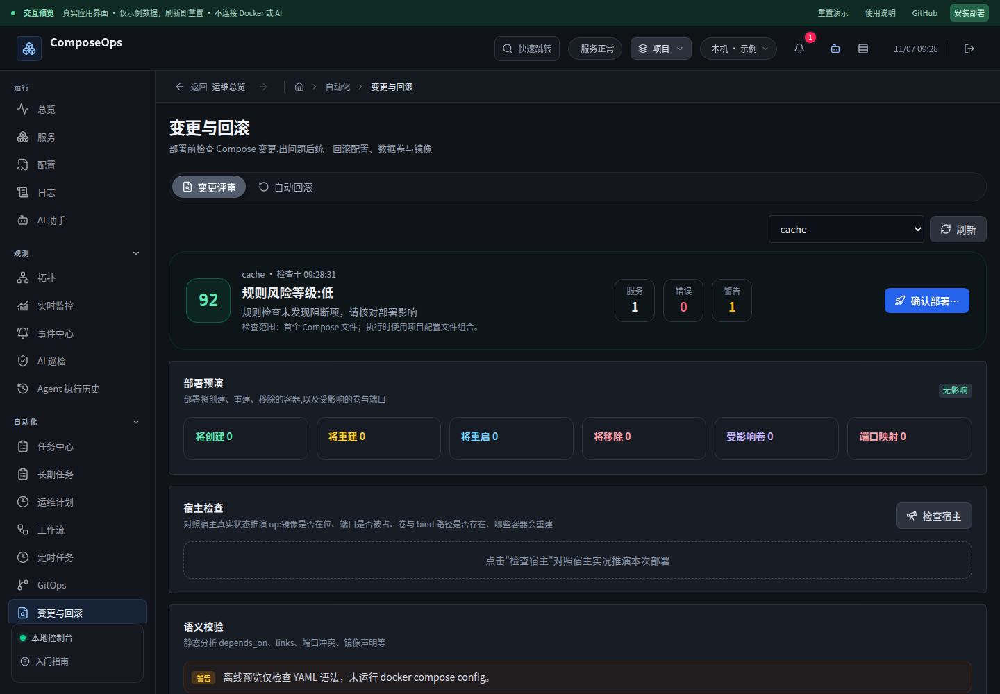
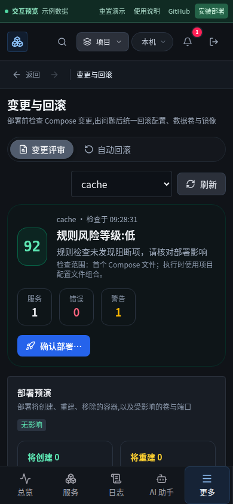
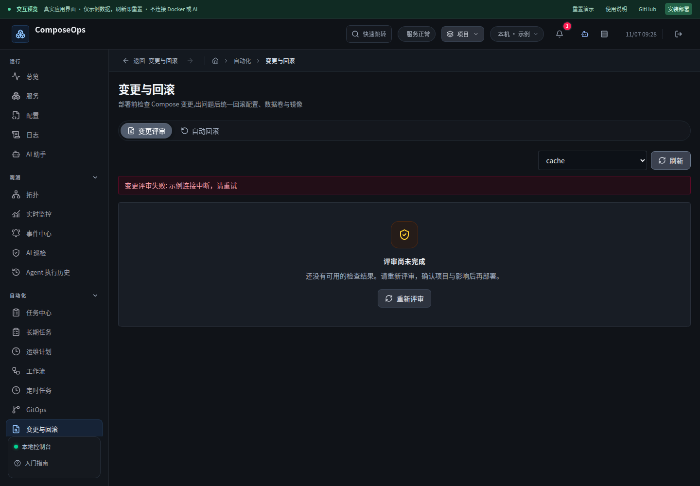

# 变更评审、部署确认与标签连续性

基线：`0c420b6`。这轮针对复查中实际复现的问题修复，没有把上一轮通过的回归当作“全站没有缺陷”。

## 已复现与修复

- 读取配置失败时，旧实现仍用空数组计算出 100 分、显示“配置健康，可安全部署”，并允许打开部署确认。现在加载中、失败和完成分别呈现；结果缺失或结构不完整时不显示通过评分，也不能部署。
- 从项目 A 快速切换到 B，A 的迟到配置曾使用 B 的 ID 继续校验。现在每轮固定项目 ID 和请求版本，在读取、校验、解析和宿主检查之后逐次验证上下文。节点变化、失活和卸载都会让旧请求失效。
- 部署确认固定已评审的项目、配置和节点。前端确认时重新读取文件；后端在请求入口以及取得项目操作锁之后再次核对，变更则拒绝。已有普通项目操作保持兼容，新增保护只应用于携带评审上下文的部署。
- 部署结果保留可重新打开的输出入口；执行期间禁止重复提交和竞争标签切换。连接中断而无法确定结果时显示“结果未确认”。
- “变更评审／自动回滚”标签缓存各自项目和结果，支持浏览器后退、前进；失活时取消确认、关闭浮层、暂停下拉刷新并隔离迟到响应。
- “AI 评审建议”改为准确的“规则检查建议”，说明规则分数不是部署成功率；宿主检查默认只执行静态检查，不隐式调用付费模型。
- 统计摘要收紧，分区增加间距，加载与失败状态提供明确的恢复入口。320px 布局仍可使用。

## 参考与范围

状态反馈和恢复入口延续前一轮参考的 Carbon 设计规范；本轮实现核对了 Vue 官方 KeepAlive 生命周期文档，缓存组件同时处理激活、失活与卸载。

当前规则评审检查首个 Compose 文件，页面明确展示范围；实际部署仍使用项目的配置文件组合。未将这一检查宣称为全部配置、环境变量、外部依赖或 Docker 启动行为的完备证明。文件版本核对也不是对外部编辑器的文件锁。

## 验证

前端 86 个文件、581 项通过；后端 520 项通过、1 项既有条件跳过；全站 Chromium/WebKit 桌面与手机 212 项通过、8 项设备条件跳过。lint 无警告，生产及预览构建通过。最终布局调整后，相关浏览器流程另测 12 项通过。新增测试覆盖失败重试、两类迟到响应、上下文失效、重复点击、部署前配置变化、缓存生命周期与服务端执行前核对。真实 Docker 测试仅操作随机命名临时项目，并自动清理。

## 界面

发布前生成 575,029,248 字节加密数据库快照，权限 0600，保存在数据卷与仓库之外；保留原镜像回退标签。发布不改变端口映射、数据卷和外置密钥。
