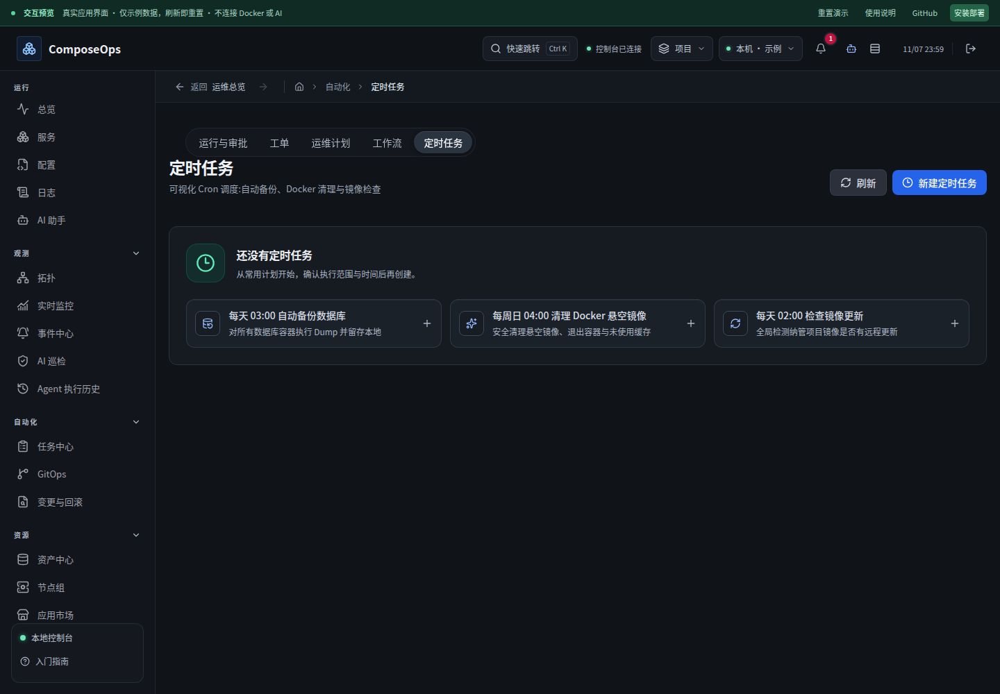
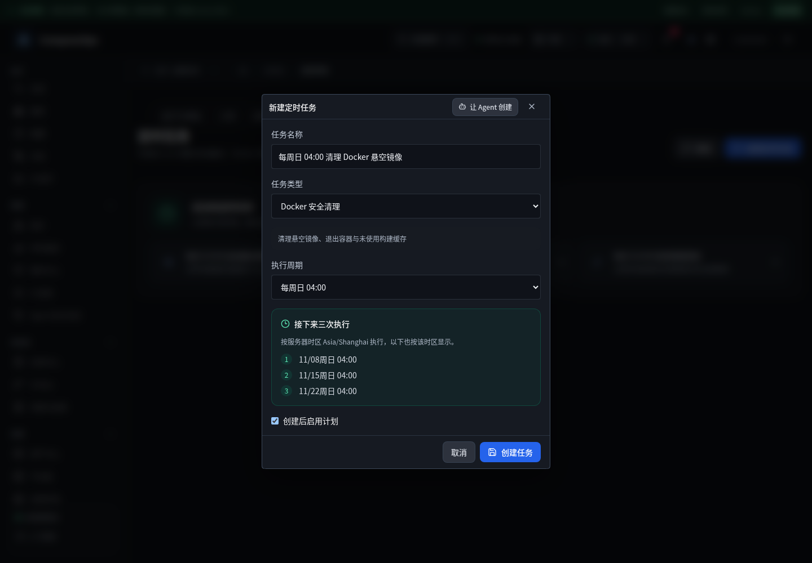

# 定时任务创建、时间预览与首次执行

基线 `11640b0`。快捷预设“每周日 04:00”在原表单没有对应选项，显示空白；自定义周期与下拉共用值，关闭后模式还会残留。原“下一次执行：格式正确”只判断五段字符串，既没有执行时间，也不能识别越界。

## 修复与设计

- 快捷计划集中到紧凑起步区，手机显示完整说明；弹窗分为名称、任务范围、周期、三次执行预览。
- 新增只读 `/cron/preview`，复用服务端调度解析器，展示明确时区；拒绝越界、倒序、非整数字段及未来五年不可能执行的日期。
- 支持先保存停用计划；保存期间锁定表单和关闭入口；预览隔离迟到响应，重复启停与执行有忙碌保护。
- 历史独立于现存任务显示；删除最后一个任务后历史仍可查看，深链筛选可以清除。
- 修复首次调度：之前 `lastRunAt=null` 每次扫描都从“现在”重新寻找下个时刻，任务始终不会到期。现在保存固定调度起点；创建、改周期与重新启用建立起点。升级时从未运行过的旧任务从升级时刻安排，不补跑历史周期。
- 同时修复 update 校验失败前的部分内存修改。
- 公开预览提供内存中的创建、启停、删除和时间预览；不执行真实任务。

## 验证

前端全量 634 项通过；后端 564 项通过、1 项既有跳过。定时任务浏览器 8 项通过，覆盖 Chromium/WebKit 桌面与手机、320px、预设/自定义切换、非法表达式、取消重开、保存、启停和删除确认。lint 与预览构建通过。

后端专门测试推进时间、触发实际 tick 并检查落库历史：首次到点一次执行、并发扫描不重复、重新启用不补跑停用期间；隔离执行器故意失败，未访问真实 Docker、网络或模型。API 预览测试验证不创建任务。

发布回归补充：全站浏览器检查发现旧用例仍使用已替换的 placeholder，并把预览创建任务预期为不支持。用例改用「任务名称」标签定位，主动模拟一次 503，验证失败保留草稿且无假成功记录、重试后才出现任务；四种浏览器环境全部通过。运行时代码无需改动。
