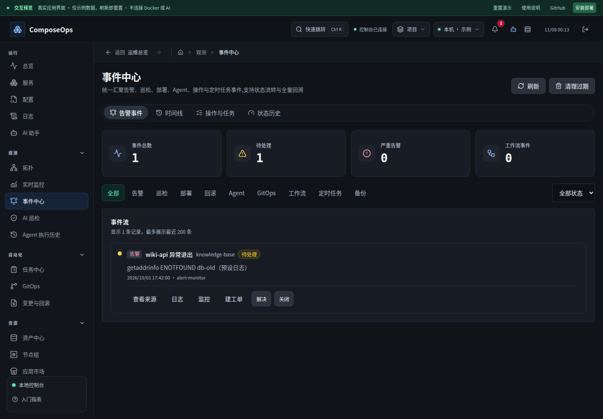
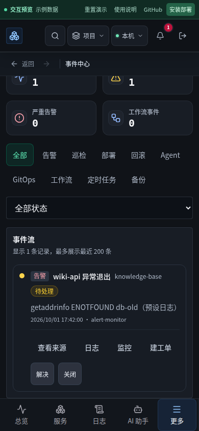

# 事件处理与触屏连续操作

基线 `cb51156`。本轮针对事件处理状态不可见、窄屏按钮挤压正文，以及预览数据结构漂移修复。

- 事件显示待处理、已确认、已解决、已关闭；状态动作随结果变化，支持重新打开；提交中禁用重复动作。
- 类型与状态筛选进入 URL，浏览器返回/前进恢复条件；无匹配结果可清除筛选。统计明确缺少类别为零，不显示含糊的破折号。
- 数据请求隔离旧结果；状态修改后按最新筛选重读，清理后保留当前条件。
- 手机统计收紧、正文和动作分行，触控面积保持 44px。日期统一按 API 时间格式解析，SQLite UTC 不再被当作本地时间。
- 预览提供准确的事件字段、统计结构和内存状态修改；修复 Agent 历史 undefined 和审计空态的错误提示。
- 真实手机流程复现 Toast 的合成 mouseenter 导致永久悬停暂停、挡住下一步按钮。仅真正支持 hover 的设备暂停悬停计时，保留焦点与按住阅读保护。

设计取舍沿用本轮已阅读的 Carbon 空态与集中筛选原则，研究记录见 `2026-11-07-market-catalog.md`。这轮不增加新的运维权限。

针对性单测 12 项通过；事件浏览器流程 8 项通过，覆盖 Chromium/WebKit 桌面与手机：解决、重新打开、状态/类型筛选、浏览器回退、日志来源返回及 320px 正文宽度。最终全量验证与部署记录保存在仓外 release 证据目录。

