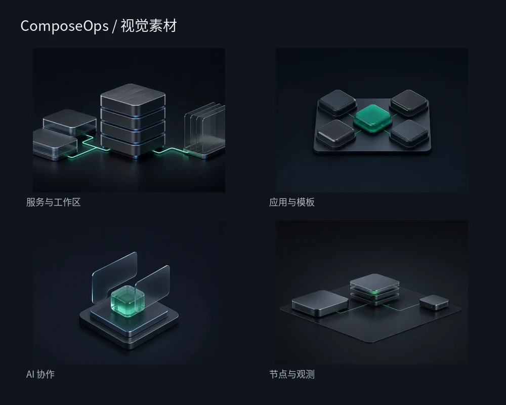
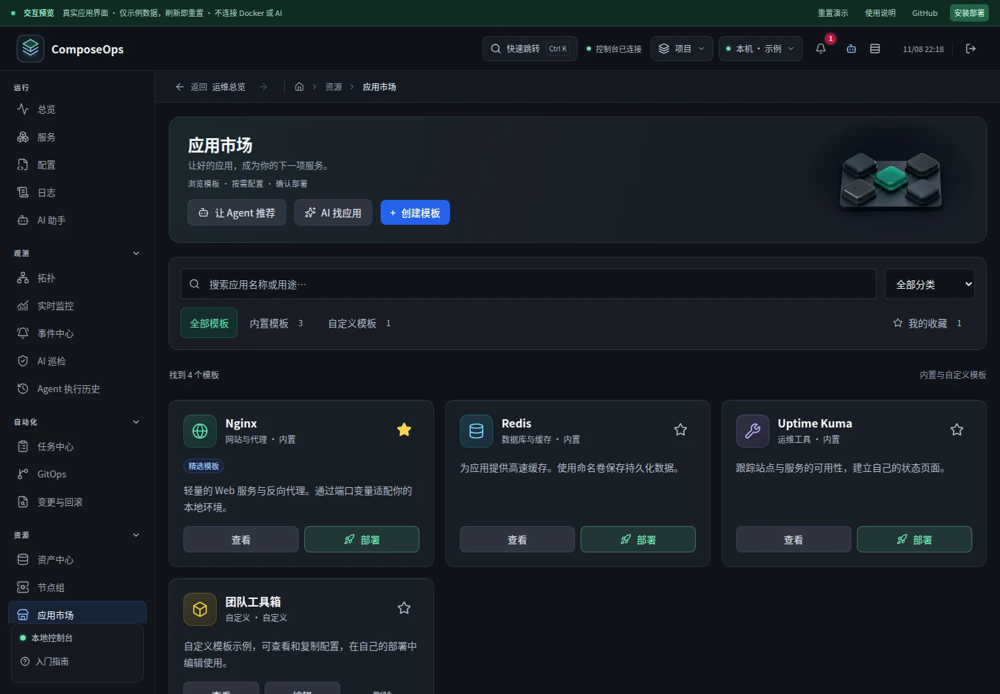
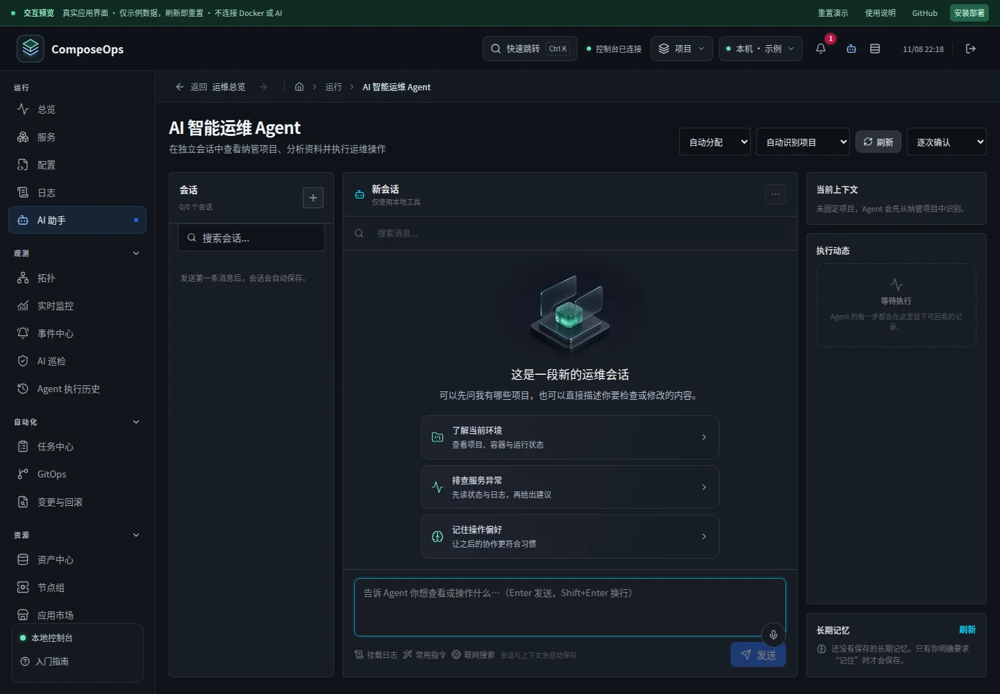
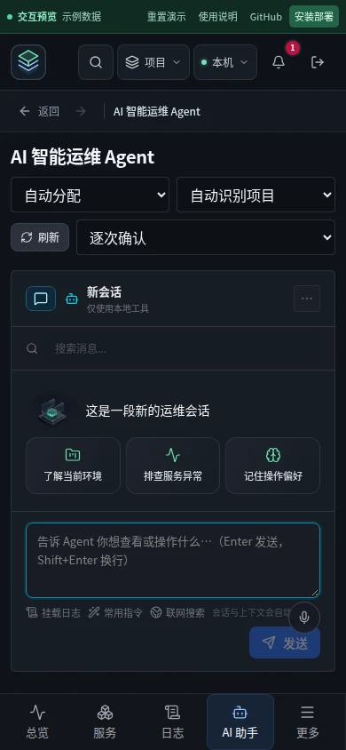
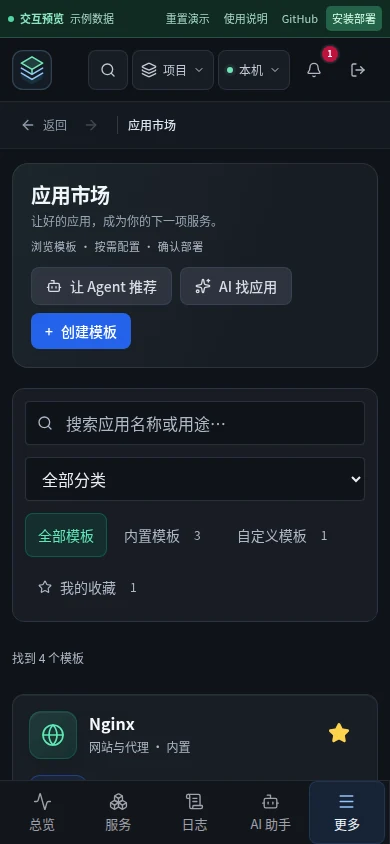
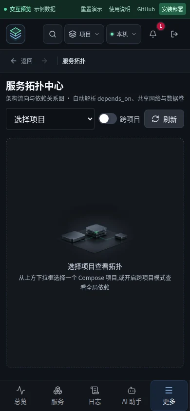

# 2026-11-08 全站视觉素材与起步体验打磨

本轮在已完成的十一月功能批次上补齐产品视觉语言，未重新混合提交后端批次。生成素材、品牌矢量、功能图标分别按用途处理，避免把状态和操作画进不可访问的图片中。

## 素材覆盖

| 场景 | 处理 | 使用位置 |
| --- | --- | --- |
| 登录与基础设施 | 沿用已选定的 l0veyou 服务器原图，重新裁切为同族插画 | 登录、入门指南、项目/配置/节点空态 |
| 应用模块 | l0veyou GPT Image 2 新生成，4:3，1024×768 | 应用市场页头、应用类空态 |
| 协作核心 | l0veyou GPT Image 2 新生成，4:3，1024×768 | Agent 工作台、全局抽屉、助手空态 |
| 节点观测 | l0veyou GPT Image 2 新生成，4:3，1024×768 | 拓扑及观测类空态 |
| 品牌标识 | 同一份 SVG 源生成各尺寸图标 | 顶栏、登录、favicon、Apple Touch、PWA |
| 功能图标与搜索空态 | 保持 Lucide 矢量，统一线宽、材质、色阶和反馈 | 侧栏、市场类别、收藏、部署按钮、紧凑空态 |

提示词、任务 ID、原图、裁切和压缩参数见 [素材溯源](../../images/composeops-scenes-provenance.json)。原始 PNG 保留在 images/；生产端只加载优化后的 WebP。

## 交互与布局

- Agent 起步入口改为三个明确任务卡：了解环境、只读排障、记录偏好。点击只填写草稿并聚焦输入框，发送仍由用户决定。
- 桌面保留插画与解释文案；手机改为 60px 小图和三列紧凑入口。390×844 首屏可同时看见起步卡、输入框、发送按钮和底部导航。
- 市场页头、模板分类图标、收藏状态与部署按钮有一致的细节反馈。位移动效仅在支持悬停的指针上启用，减少动态效果偏好会关闭过渡。
- 引导入口跳转后关闭，返回不重新弹出；拓扑选中项目后插画让位于真实数据。
- 插画为装饰内容，空 alt 且 aria-hidden；业务说明和操作始终保留为可访问的 HTML。图片失败显示矢量退路。
- 品牌图标由 scripts/render-brand-assets.mjs 复现，避免不同入口各画一份。

## 性能

场景插画各含 400px / 800px 两档，浏览器按实际展示尺寸选择；每张约 3.6–19.9 KB。固定宽高比避免布局跳动，默认懒加载。市场手机布局隐藏插画时不请求图片。所有场景导入使用 Vite `?no-inline`，防止小于默认阈值的图像被内联到 JS 而失去按需加载效果。

## 验证

- 前端单元测试：98 个文件、637 项通过。
- 最终生产构建、交互预览构建、前端 ESLint、git diff --check 通过。
- 四项目浏览器矩阵：Chrome 桌面、Pixel 7、WebKit 桌面、iPhone 13，共 356 项；8 项为仅手机场景在桌面上的预期跳过。
- 首轮 347 项通过，1 项在页面加载阶段遇到本机 `net::ERR_NETWORK_CHANGED`，trace 显示多份 CSS/JS 同时加载中断，尚未进入操作步骤。该用例在其他三项目通过；在相同产物上单独重复三次确认。
- 新增 16 项跨浏览器场景覆盖：按屏幕加载、图片失败退路、只读排障预填、键盘焦点、减少动态效果、引导跳转/返回、拓扑空态切换。
- Playwright 预览使用示例数据隔离真实 Docker。生产上线另核对健康接口、鉴权、静态文件哈希、数据卷/密钥挂载、加密数据与记录数量；不会把示例数据测试当成真实环境运维操作。
- 本机 WebKit 缺失依赖使用发布证据目录下的局部动态库补齐，不修改项目依赖或系统库。

运行日志与加密备份只保存在本机发布证据目录，不进入 git。

## 实际截图

| Agent 手机 | 市场手机 | 拓扑手机 |
| --- | --- | --- |
|  |  |  |

## 参考原则

沿用前序对 Carbon empty states、Adobe Spectrum illustrated message 的调研：空态应说明当前状态与下一步，插画辅助识别，不代替文字、操作和真实数据。没有复制第三方图片、品牌或界面源代码。
